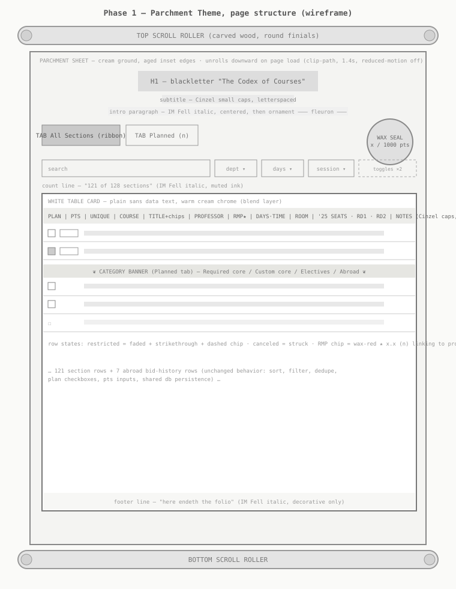

# Phase 1 Spec — Medieval Parchment Theme

**Status:** Draft for review · **Owner:** Henry McGee · **Target:** `index.html` (single-file dashboard)
**Design reference:** approved mockup canvas (Claude Design artifact "Parchment Course Planner Mockup", artboards: *Wireframe — scroll structure* and *Styled — parchment & ink*, v5)

## Context

The course planner dashboard currently uses a neutral warm-paper look. This phase reskins it as a medieval scroll: parchment sheet on a dark wood ground, scroll rollers, blackletter title, wax-seal bid budget — while keeping the data table itself plainly readable (white-ish card, sans-serif data text). The direction was iterated and approved in the mockup: the first table draft was fully stylized and was revised to "white, clear, non-stylized text, prioritize readability," then blended with warm chrome tones.

## Goals

1. Apply the approved parchment visual theme to the live dashboard.
2. Keep every existing behavior unchanged: sorting, filtering, dedupe toggle, plan checkboxes, bid points + budget, shared db persistence, Planned-tab grouping, RMP links, bid-history columns.
3. Keep the data table readable: plain sans-serif text at the current sizes, near-black on warm white, normal clock times (no Roman numerals in the table).
4. Scroll-opening animation on page load.

## Non-goals (Phase 2 candidates)

- Themed copy inside the table ("Guild", "forbidden", "no scroll", Roman-numeral hours) — rejected for readability.
- Illuminated capitals, texture images, sound, custom cursors.
- Any behavior or data changes.

## Wireframe

## Visual spec

### Layout chrome
- Page ground: dark wood vertical gradient (`#413327 → #2E2317` light mode).
- Scroll rollers: full-width bars (max-width 1248px, radius 19px) above and below the content, wood-cylinder gradient with round finials; decorative only (`aria-hidden`).
- Parchment sheet: max-width 1200px, cream radial gradient (`#FBF7EA → #F8F1DE → #F0E5C8`), soft drop shadow plus warm inset glow. All existing content (header, tabs, filters, table) lives on the sheet.

### Palette (CSS tokens, light / dark)
| Token | Light | Dark |
|---|---|---|
| `--wood` / `--wood2` | #413327 / #2E2317 | #1C1510 / #120D08 |
| `--parch` (sheet, `--bg`) | #F8F1DE | #332919 |
| `--surface` (table card) | #FFFEF9 | #272013 |
| `--fg` | #2A2117 | #EDE3CC |
| `--muted` | #7A6647 | #B5A181 |
| `--ink` (headers, labels) | #5A4226 | #D9C49A |
| `--line` / `--hairline` | #E2D5B4 / #EFE7D2 | #55452A / #453823 |
| `--accent` (wax red) | #A8352C | #DE7A62 |
| `--head` (table header band) | #F7F0DD | #3A2F1C |

Dark mode is a "night scriptorium" variant of the same scheme, not an inversion; both modes keep ≥4.5:1 body-text contrast.

### Type
- Title (h1): UnifrakturMaguntia — "The Codex of Courses", ~42px, centered.
- Subtitle, tabs, column headers, category banners: Cinzel small caps, letterspaced.
- Flavor text (intro line, count line, footer): IM Fell English italic.
- **All table data: Libre Franklin (current sans), unchanged sizes** — readability rule from review.

### Components
- Tabs: Cinzel; active tab is a deep-red ribbon (`#6E1F1A`, notched right edge via clip-path), inactive is an ink-outlined box.
- Bid budget: 92px wax seal (red radial gradient, inner ring, −6° rotation); over-budget state brightens the ring and text instead of the old red border.
- Table: white-warm card with cream Cinzel header band, warm hairlines between rows, warm chip borders, wax-red RMP chips, category banners centered with fleurons (❦).
- Row states unchanged in meaning: restricted/canceled dimmed + struck through.

### Motion
- On load, the parchment sheet unrolls downward: `clip-path inset(0 0 100% 0) → inset(0 0 -40px 0)`, 1.4s, `cubic-bezier(.22,.61,.36,1)`, 0.2s delay, runs once.
- Fully disabled under `prefers-reduced-motion: reduce`.

## Acceptance criteria

- [ ] All 14 columns render and sort exactly as before; filters, tabs, dedupe, plan/pts, and db persistence unchanged.
- [ ] Table data text is sans-serif, near-black on warm white, ≥4.5:1 contrast in both themes.
- [ ] Page works at ~400px width with no horizontal body scroll (table scrolls inside its own card).
- [ ] Unroll animation plays once on load and is absent with reduced motion.
- [ ] Dark mode renders the night-scriptorium palette with legible contrast.
- [ ] No behavior, data, or schema changes; artifact republish only after merge.

## Rollout

Single PR against `main` (stacked on PR #1). After merge, republish the live artifact from `index.html`.
